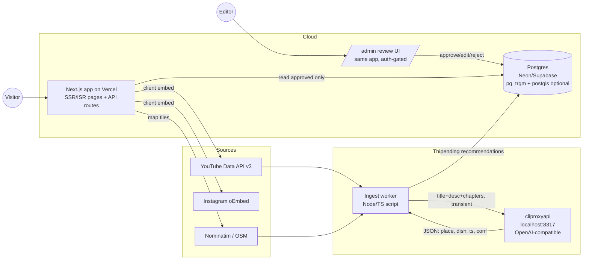
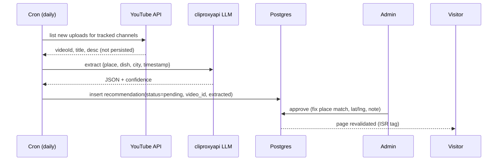

# 03 · Full-stack Architecture

## Diagram

## Data flow (one recommendation)

## Components

| Component         | Tech                                                          | Why                                                 |
| ----------------- | ------------------------------------------------------------- | --------------------------------------------------- |
| Web + API + admin | Next.js (App Router, TS), Tailwind                            | One deployable, SSR for SEO                         |
| DB                | Postgres + Drizzle ORM, `pg_trgm`                             | Fuzzy search + entity match, no extra search engine |
| Map               | MapLibre GL + OSM tiles (or MapTiler free tier)               | No Google lock-in                                   |
| Ingest            | Node/TS script in same repo (`/worker`), cron on this machine | cliproxyapi is local                                |
| LLM               | cliproxyapi `localhost:8317` via OpenAI SDK                   | Already installed                                   |
| Auth (admin only) | Auth.js with GitHub/Google allowlist                          | Simple, no user accounts                            |
| Hosting           | Vercel (web), Neon (DB)                                       | Free tiers cover MVP                                |
| Observability     | Vercel logs + Sentry free                                     | Enough for MVP                                      |
