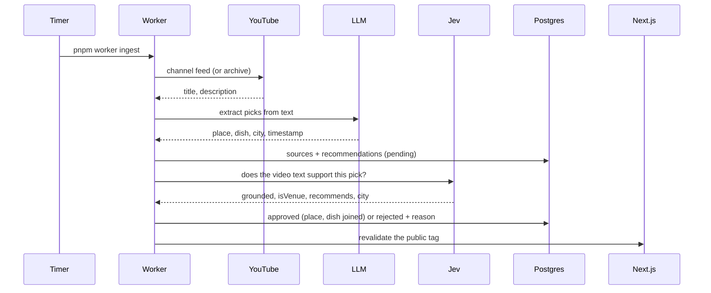
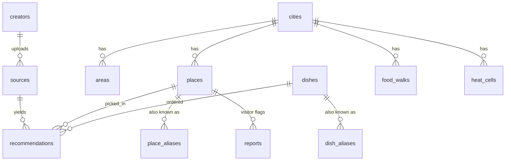

# Architecture

How the site turns creator uploads into ranked, sourced place pages. Decisions and their
trade-offs live in [`adr/`](adr/); measured numbers live in [`slo.md`](slo.md).

## System context

```mermaid
flowchart LR
  subgraph sources[Sources]
    RSS[YouTube RSS feed<br/>latest 15 uploads]
    ARCH[yt-dlp archive<br/>past the feed window]
    OSM[Nominatim / Overpass]
  end

  subgraph worker[Worker - one machine, systemd timer]
    ING[Ingest<br/>extract + match]
    REV[Auto-review<br/>verify + decide]
  end

  LLM[OpenAI-compatible LLM]
  JEV[TypeSafe Jev<br/>classifier]

  subgraph web[Next.js on Vercel]
    PROXY[proxy.ts<br/>real 404s]
    PAGES[Public pages<br/>cacheComponents]
    ADMIN[/admin<br/>Auth.js allowlist]
    API[API routes<br/>tiles, places, rating]
  end

  DB[(Postgres<br/>PostGIS + pg_trgm)]
  USER((Visitor))
  EDITOR((Maintainer))

  RSS --> ING
  ARCH --> ING
  ING --> LLM
  REV --> JEV
  ING --> REV
  REV --> DB
  ING --> DB
  OSM --> ING
  DB --> PAGES
  DB --> ADMIN
  DB --> API
  USER --> PROXY --> PAGES
  EDITOR --> ADMIN
  PAGES --> USER
```

The worker runs on the machine that can reach the LLM endpoint; the web app never calls an LLM.
That split is [ADR 0002](adr/0002-ingest-worker-runs-on-this-machine.md).

## Ingest to published pick



Three properties matter more than the mechanics:

1. **Nothing publishes without a check.** `decidePick` applies fixed thresholds to the verifier's
   answers; code, not the model, makes the decision. Reasons are stored in
   `recommendations.extracted.autoReview`.
2. **A missing check is not a rejection.** A pick whose video text could not be found is
   `no-video-text` and stays retryable (`pnpm worker retry-unchecked`), never silently refused.
3. **One row per (video, place, dish, timestamp)**, enforced by a partial unique index, so
   re-running ingest cannot inflate a rank.

## Data model



| Table                   | Holds                      | Notes                                                                           |
| ----------------------- | -------------------------- | ------------------------------------------------------------------------------- |
| `creators`              | channel, slug, `opted_out` | Opt-out removes every pick from the site                                        |
| `sources`               | one row per video          | Video ID only; no titles or descriptions are stored                             |
| `recommendations`       | one pick                   | `status`, `origin`, `ts_seconds`, `extracted` JSONB                             |
| `places`                | shop, city, pin            | `status` open/closed/moved; `osm_id` `approx:` prefix marks a neighbourhood pin |
| `dishes`                | canonical dish             | Variants folded by `canonicalDishName`                                          |
| `areas`, `area_aliases` | neighbourhood gazetteer    | Local matching before any outbound geocode                                      |
| `reports`               | visitor "closed or moved"  | Hashed IP, three distinct reporters raise a flag                                |
| `rate_limits`           | Postgres token bucket      | Survives cold starts and multiple instances                                     |

## Rank and order

`score = distinct_creators × 10 + recency_bonus(0–5)`, then ties by distinct videos, distinct
dishes, exact pin before approximate, newest pick, name. The rule is stated to visitors on
`/about`; there are no paid placements.

Splitting one shop across two rows halves its creator count, so publishing matches new picks to
existing places with `samePlace` (shop-type words, brackets and trailing locality ignored;
conflicting localities never merged). `pnpm worker dedupe-places` reports pairs, `--apply` merges.

## Request path and caching

- `proxy.ts` answers unknown slugs with a real 404 before rendering. A cached index is served
  immediately and refreshed after the response, so page reads do not wait on it.
- Public reads are cached with `cacheComponents` and tagged `public`; the worker revalidates that
  tag after a run.
- Map data comes from MVT tiles built in Postgres (`ST_AsMVT`), filtered by the GiST index first.
- Reads are capped per client by a Postgres token bucket. Preview deployments open the database
  read-only (`db/guard.ts`), so a preview cannot mutate production.

## Where things live

| Path                 | What                                                                         |
| -------------------- | ---------------------------------------------------------------------------- |
| `app/(public)`       | Visitor pages: home, city, dish, place, creator, area, walk, list, search    |
| `app/admin`          | Queue, stale places, search misses, duplicate dishes and places, worker runs |
| `app/api`            | Tiles, viewport search, near-me index, rating, report, submit, revalidate    |
| `lib/public`         | Queries, ranking, search, spatial filters, link builders                     |
| `lib/worker`         | Ingest, run log, geocoding, area import, dedupe, retry                       |
| `lib/llm`, `lib/jev` | Extraction prompt and verifier calls                                         |
| `db`                 | Drizzle schema, migrations, guards, seeds                                    |
| `worker`             | CLI entry points and the deep backfill                                       |
| `ops`                | systemd units, backup, restore drill, alerting, load test                    |

## Failure behaviour

| Failure                              | What happens                                                              |
| ------------------------------------ | ------------------------------------------------------------------------- |
| LLM or verifier down                 | Pick stays `pending`, retried next run; the run exits non-zero and alerts |
| Video text gone                      | `no-video-text`, retryable, never published                               |
| Worker killed                        | Run row closed as failed after two hours, never looks alive               |
| Geocoder rate limit                  | Place is stored without a pin; the page says the location is approximate  |
| Public database write from a preview | Refused with 503, rate limits skipped instead of failing                  |

## Tests that guard the invariants

`pnpm test` covers the decision thresholds, dedupe index, place matching, ranking order, and the
migration safety check. `pnpm e2e` runs the site in a browser, including axe accessibility checks
and a no-horizontal-overflow assertion at 360 px.
